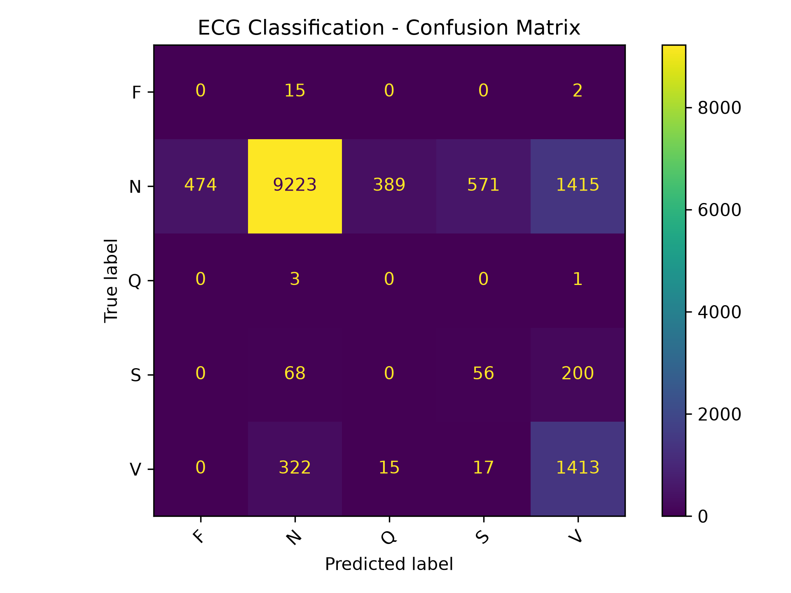
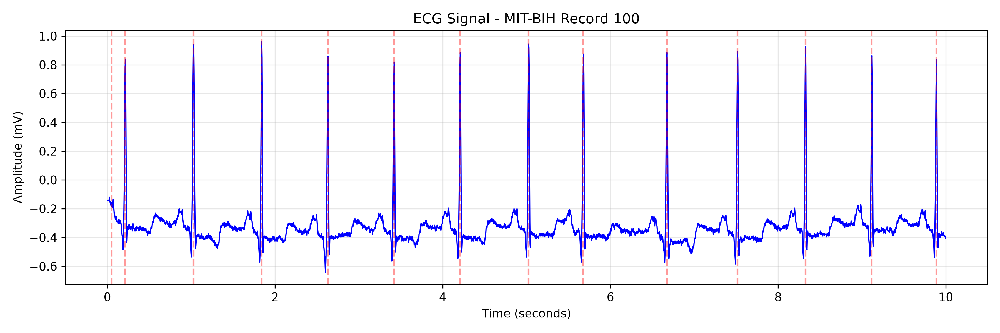

# ECG Beat Classification Using Machine Learning

## Project Overview

This project uses Python and Machine Learning to classify ECG heartbeats into five categories. It uses numerical features extracted from ECG signals and a Random Forest classifier.

The project focuses on heartbeat classification rather than clinical diagnosis of specific heart diseases.

## Dataset

The MIT-BIH Arrhythmia Database from PhysioNet is used.

Dataset: https://physionet.org/content/mitdb/1.0.0/

- 42 ECG recordings for training
- 6 separate ECG recordings for testing
- 95,214 training beats
- 14,184 testing beats

The WFDB library is used to load ECG signals and reference heartbeat annotations.

## Classification Categories

MIT-BIH annotation symbols are mapped into five AAMI-style heartbeat categories:

- N: Normal and related beats
- S: Supraventricular ectopic beats
- V: Ventricular ectopic beats
- F: Fusion beats
- Q: Unknown or unclassifiable beats

## Methodology

1. Load ECG signals and annotations using WFDB.
2. Extract 10 numerical features from each heartbeat.
3. Map heartbeat annotations to five categories.
4. Train a Random Forest classifier with 100 trees.
5. Evaluate the classifier on separate ECG recordings.
6. Visualize an ECG signal and the classification confusion matrix.

## Extracted Features

1. Previous RR interval
2. Next RR interval
3. RR interval ratio
4. Approximate heart rate
5. Amplitude range
6. Mean amplitude
7. Standard deviation
8. Signal energy
9. Skewness
10. Kurtosis

## Experimental Results

The final model was evaluated on 14,184 test beats.

- Accuracy: 75.38%
- Macro F1-score: 0.31
- Weighted F1-score: 0.80

### Classification Report

| Class | Precision | Recall | F1-score |
|---|---:|---:|---:|
| F | 0.00 | 0.00 | 0.00 |
| N | 0.96 | 0.76 | 0.85 |
| Q | 0.00 | 0.00 | 0.00 |
| S | 0.09 | 0.17 | 0.12 |
| V | 0.47 | 0.80 | 0.59 |

### Confusion Matrix



### ECG Signal Visualization



## Project Structure

- main.py: Main training and evaluation pipeline
- data_loader.py: ECG data loading
- feature_extraction.py: ECG feature extraction
- model.py: Random Forest training and evaluation
- ecg_visualization.py: ECG signal visualization
- requirements.txt: Python dependencies
- results/: Generated plots

## Installation

Install dependencies:

```bash
pip install -r requirements.txt
```

## Running the Project

Train and evaluate the model:

```bash
python main.py
```

Generate the ECG visualization:

```bash
python ecg_visualization.py
```

An internet connection is required to retrieve MIT-BIH recordings from PhysioNet.

## Limitations

The dataset is highly imbalanced, and the model performs poorly on some minority classes, especially F and Q.

The model uses annotated heartbeat locations supplied by the dataset rather than detecting beats independently.

Training and testing use separate record IDs, but patient-level independence is not guaranteed.

The classifier is an educational demonstration and is not suitable for clinical diagnosis.

## Conclusion

This project demonstrates ECG signal processing, numerical feature extraction, and multi-class heartbeat classification using traditional Machine Learning.

Adding more features and training recordings improved several evaluation metrics, although minority-class classification remains challenging.
